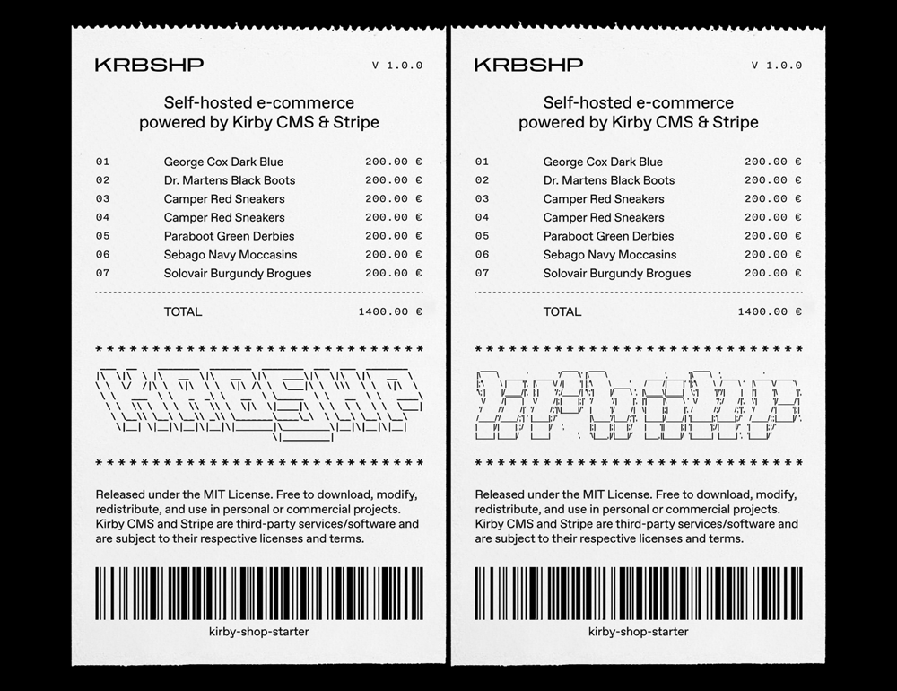

# KirbyShop

A self-hosted e-commerce starter built on [Kirby CMS](https://getkirby.com) with Stripe Checkout, for developers who need to ship a cost-effective online shop for clients with moderate needs.



**Stack:** Kirby 5 · Stripe Checkout · Vite + SCSS · PHP ≥ 8.2, Composer, Node.js (or Docker)

## Getting started

```bash
git clone https://github.com/ambientmoxie/kirby-shop.git
cd kirby-shop
composer install
npm install
cp .env-example .env   # add your Stripe keys and SMTP credentials
npm run dev
```

The site runs on `localhost:8888`. Open `localhost:8888/panel` to create your admin account. With Docker instead: `docker compose up --build`.

Keep `VITE_DEV=true` in `.env` for local work: it serves assets from Vite, enables debug mode, uses the Stripe **test** keys and allows installing the panel.

## Features

- **Cart**: session-based, in a slide-over drawer. Prices and stock always come from the product pages, never the browser.
- **Stripe Checkout**, or **manual payment** when Stripe is turned off in the panel.
- **Stock reservation** during payment, so the last unit can't be sold twice.
- **Orders** as Kirby pages, managed from the panel, each with a readable number (`KS-2026-000128`).
- **Emails**: receipt to the buyer, summary to the admin.
- **Newsletter** signup, stored in the panel.

## How checkout works

1. When the customer places the order, it is saved as *pending* with a copy of its items, prices and buyer, and its stock is reserved for 40 minutes. Adding to the cart reserves nothing.
2. The customer pays on Stripe (the session expires after 31 minutes, before the reservation).
3. Back on the success page, the payment is verified with Stripe. The order moves through *confirmed* → *inventory processed* → *completed*, each step saved so a failure can be retried without repeating the others.
4. Unpaid reservations expire on their own. Expired Stripe sessions are checked at the next checkout: paid ones are completed, unpaid ones deleted.

Without Stripe, the order is confirmed and its stock decremented right away, so no reservation is held: the vendor collects payment.

In the panel, orders are sorted into **To fulfil**, **Awaiting payment**, **Complete** and **Issue**. An order lands in *Issue* when a step fails (wrong amount, stock shortage…), with the error shown on the order.

## Project structure

```
assets/              # Source JS and SCSS (abstracts, base, layout, sections, components, pages)
content/             # Pages, products and orders
public/              # Document root: index.php, build/ (generated)
site/
  blueprints/        # Panel forms
  controllers/       # Checkout, success, newsletter
  plugins/kstore/    # Store logic
    src/cart/        #   cart routes
    src/orders/      #   order lifecycle, stock, numbers, emails
    src/stripe.php   #   Stripe checks
  snippets/          # layout, sections, components
  templates/         # home, checkout, success, emails
  storage/           # order counter and locks (generated, not in git)
```

## Environment variables

| Variable | Description |
|---|---|
| `VITE_DEV` | `true` in local dev only, remove on the live server |
| `STRIPE_LIVE_PUBLIC_KEY` / `STRIPE_LIVE_SECRET_KEY` | Stripe live keys |
| `STRIPE_TEST_PUBLIC_KEY` / `STRIPE_TEST_SECRET_KEY` | Stripe test keys |
| `EMAIL_HOST` / `EMAIL_PORT` | SMTP server |
| `EMAIL_USERNAME` / `EMAIL_PASSWORD` | SMTP login. The username is also the sender and admin address |

## Deploy

Remove `VITE_DEV` from `.env`, then build and preview:

```bash
npm run preview
```

On the server, PHP needs write access to `content/`, `site/sessions/` and `site/storage/`. Keep `site/storage/` between deploys (if lost, the order counter is rebuilt from existing orders).

## License

[MIT](LICENSE). This is a work in progress and may contain bugs or security flaws: use it at your own risk.
